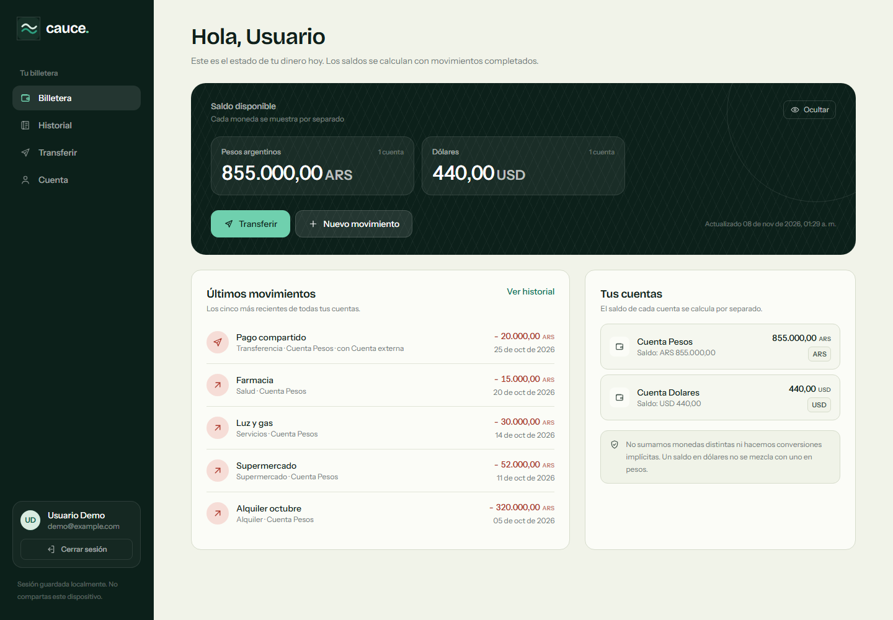
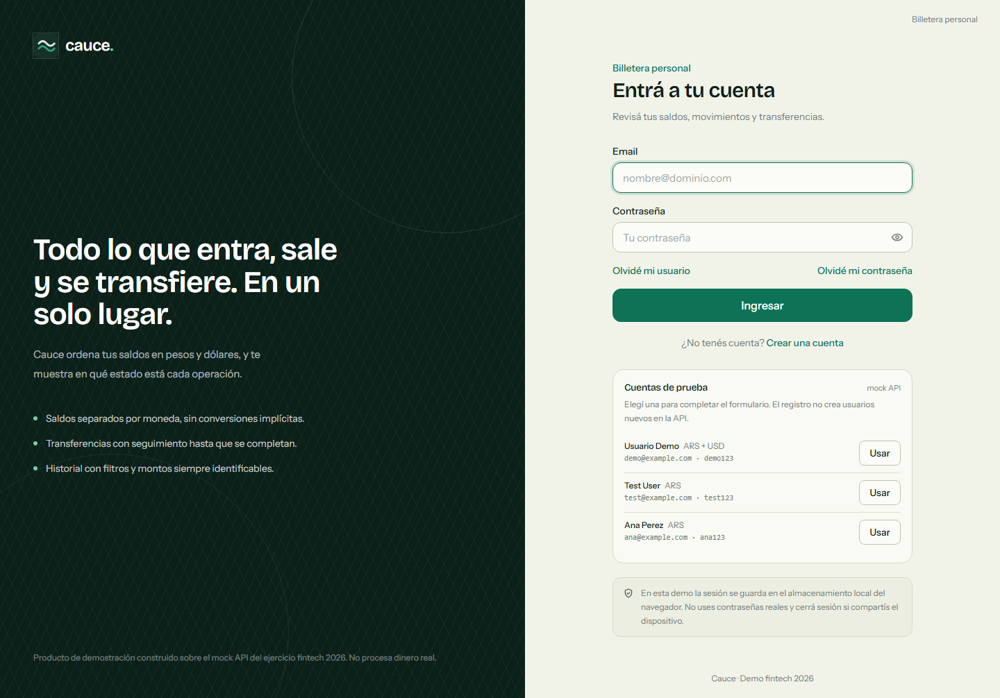
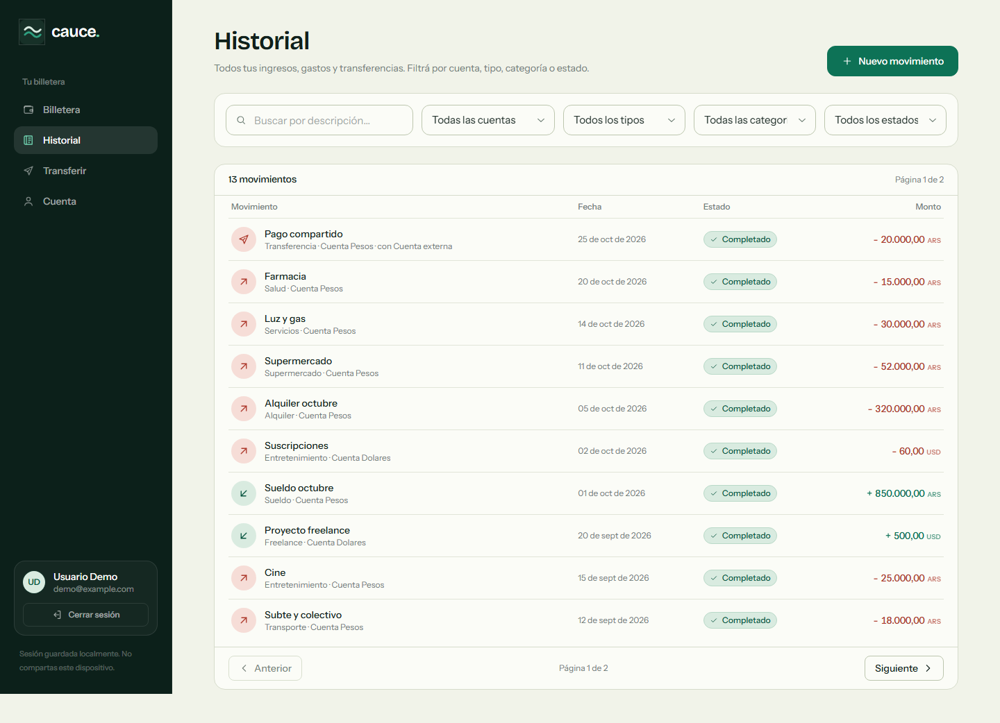
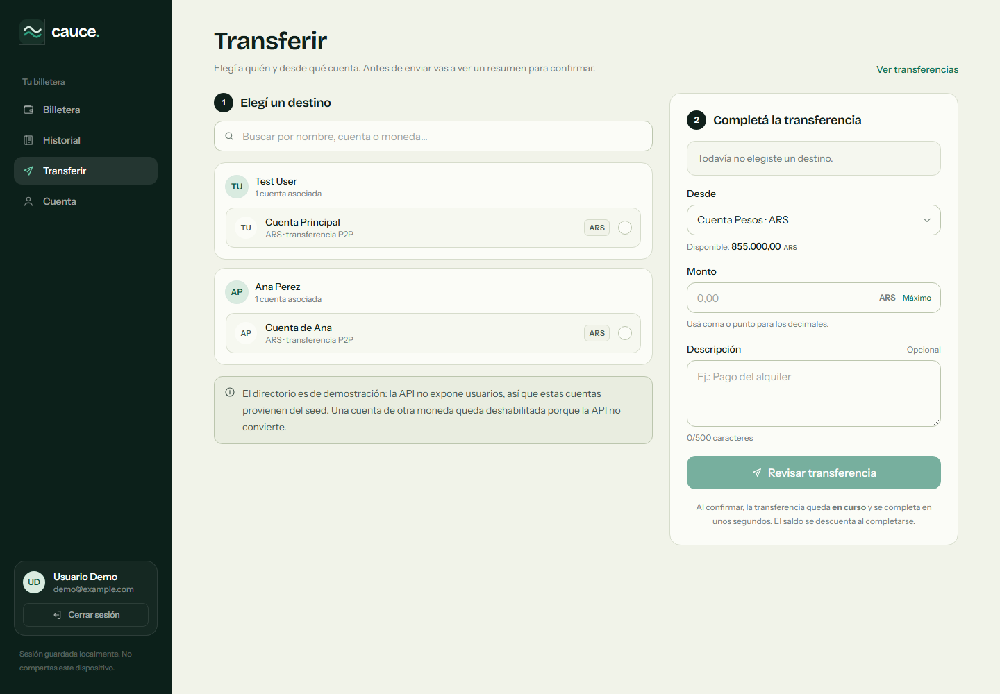
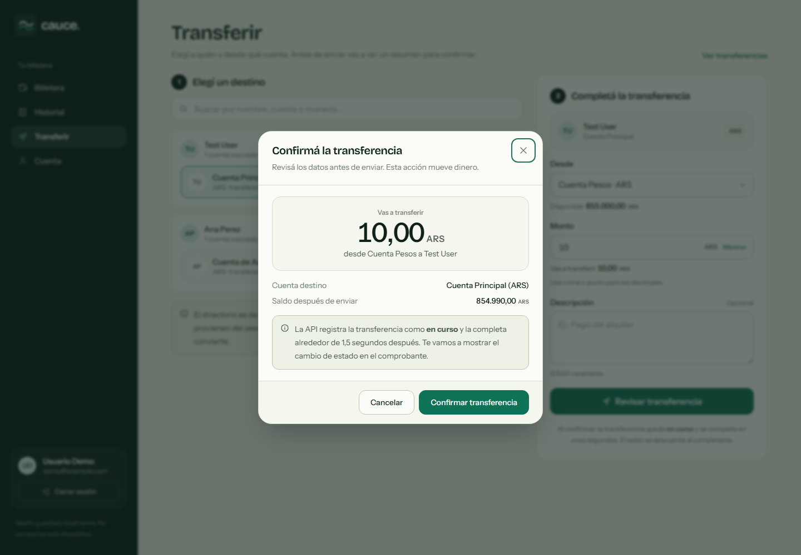
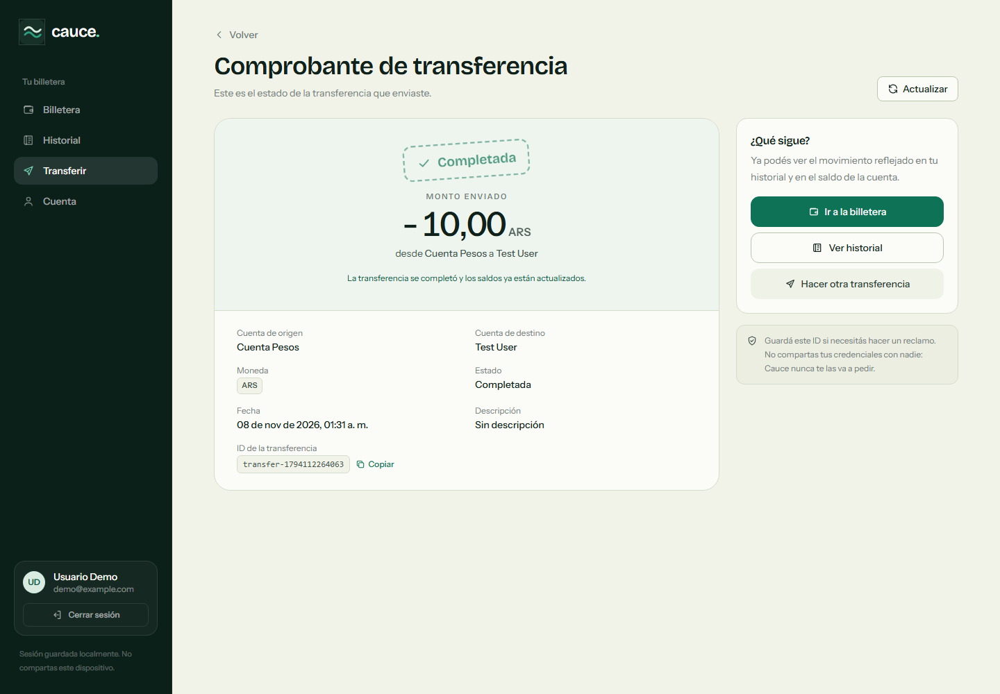
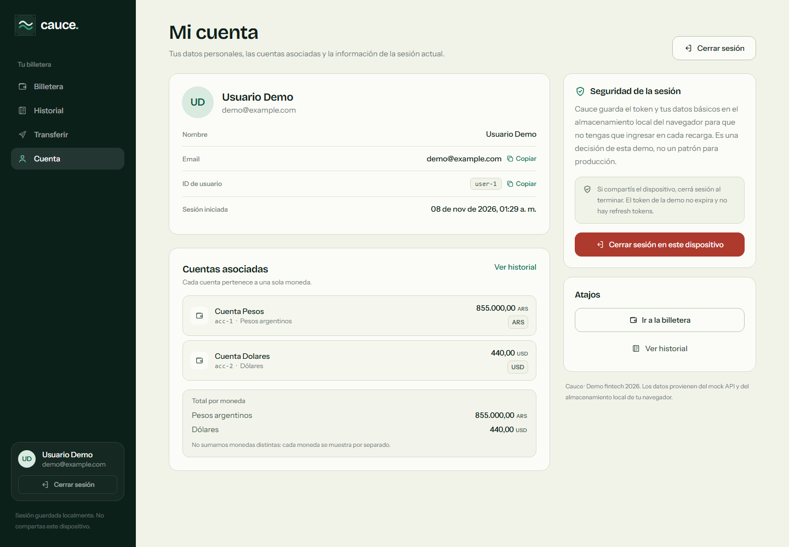

# Cauce — Billetera virtual

Frontend del ejercicio de Frontend Developer 2026. Es una billetera virtual construida con
React + TypeScript sobre el [`mock-api`](./mock-api) incluido en el repositorio.

La app prioriza lo que el ejercicio pide: **datos de dinero** (montos, monedas y estados de una
operación), errores y validaciones, seguridad, experiencia de usuario y testeo.



## Stack

| Pieza | Tecnología |
| --- | --- |
| UI | React 19 + TypeScript |
| Build | Vite |
| Ruteo | React Router |
| Datos remotos | TanStack Query |
| Formularios y validación | Validación propia en `domain` |
| Estilos | Tailwind CSS v4 + tokens de diseño propios |
| Tests | Vitest + Testing Library + MSW |
| Tipografías | Bricolage Grotesque + Instrument Sans (Fontsource) |

## Cómo correrlo

Requisitos: Node.js 20 o superior y npm.

### 1. Mock API

```bash
cd mock-api
npm install
npm run seed   # crea data.db con usuarios, cuentas y movimientos de ejemplo
npm run dev    # http://localhost:3000
```

`npm run seed` se puede volver a ejecutar en cualquier momento para resetear los datos.

### 2. Frontend

En otra terminal:

```bash
cd frontend
npm install
npm run dev    # http://localhost:5173
```

La URL de la API se puede cambiar con `VITE_API_BASE_URL`; por defecto apunta a
`http://localhost:3000`.

> En Windows, si PowerShell bloquea los scripts de npm, usá `npm.cmd` (`npm.cmd run dev`,
> `npm.cmd test`, etc.).

### Usuarios de prueba

| Email | Contraseña | Cuentas |
| --- | --- | --- |
| `demo@example.com` | `demo123` | Pesos (ARS) y Dólares (USD) |
| `test@example.com` | `test123` | Pesos (ARS) |
| `ana@example.com` | `ana123` | Pesos (ARS) |

El login también tiene un botón para completar las credenciales de demo con un clic.

## Funcionalidades

- **Login real contra la API** con validación de email y contraseña, manejo de credenciales
  incorrectas y bloqueo del botón mientras se envía.
- **Sesión persistida** en `localStorage` (token + datos del usuario + fecha de ingreso) para
  reutilizarla en los endpoints y sobrevivir recargas.
- **Olvidé mi usuario** y **olvidé mi contraseña**: flujos ilustrativos con respuesta neutra para
  no filtrar si una cuenta existe; la demo no envía emails.
- **Registro ilustrativo**: valida nombre, email, contraseña, confirmación y términos, pero no crea
  usuarios en la API. Al terminar redirige al login con un aviso.
- **Billetera personal**: saldos ARS y USD agrupados por moneda y últimas transacciones.
- **Historial**: filtros por cuenta, tipo, categoría, estado y búsqueda, con paginación y estado en
  la URL.
- **Transferir**: directorio de contactos del seed, selección de cuenta de origen, validación de
  monto, moneda y saldo, confirmación y comprobante con estado en vivo.
- **Cuenta**: datos del usuario, cuentas asociadas, información de la sesión actual y cierre de
  sesión.
- **Estados de UI**: carga, error con reintento, vacío, avisos, toasts y estados de operación
  (`En curso`, `Completada`, `Fallida`).
- **Accesibilidad y UX**: foco visible, etiquetas asociadas, `aria-live` en estados relevantes,
  navegación por teclado, montos con cifras tabulares y layout responsive.

### Flujo de transferencia

1. Elegís un contacto y una cuenta de origen de la misma moneda.
2. El monto se valida en el cliente: formato, mínimo, máximo y saldo disponible.
3. Un modal resume destinatario, cuenta, monto y saldo resultante.
4. La API crea la transferencia en estado `pending`.
5. El comprobante consulta el estado cada segundo hasta que pasa a `completed` o `failed`.
6. Al liquidarse se invalidan cuentas y transacciones para refrescar saldos e historial.

Las transferencias entre monedas distintas se bloquean con una explicación, porque la API no hace
conversión.

## Decisiones

Los criterios de producto y los trade-offs técnicos están documentados en
[`DECISIONS.md`](./DECISIONS.md). Los puntos principales:

- Montos en **centavos enteros** dentro del dominio; decimales solo en el borde de la API.
- Las monedas **nunca se suman entre sí**: se muestran agrupadas por moneda.
- Una operación `pending` no altera el saldo mostrado hasta que se completa.
- El cliente bloquea gastos y transferencias sin saldo suficiente; el `422` de la API se maneja
  como segunda barrera.

## Arquitectura

```text
frontend/src/
  app/            providers, router, layouts, rutas protegidas
  domain/         reglas puras: dinero, auth, transferencias, historial, contactos
  infrastructure/ cliente HTTP tipado, schemas Zod, sesión, errores
  features/       auth, wallet, history, transactions, transfer, account
  ui/             componentes reutilizables (Button, Money, Modal, Toast, estados)
  shared/         utilidades y query keys
  test/           setup de MSW y helpers de render
```

La dirección de dependencias va de `features`/`ui` hacia `domain` e `infrastructure`. El dominio no
conoce React ni la API, lo que permite testear las reglas de dinero y transferencias con tests
unitarios rápidos.

## Tests

```bash
cd frontend
npm.cmd test        # suite completa
npm.cmd test:watch  # modo interactivo
npm.cmd run build   # typecheck + build de producción
```

La suite actual tiene **10 archivos y 94 tests**. Cubre:

- parseo, formateo, suma/resta y comparación de dinero en centavos;
- validaciones de login, registro y fortaleza de contraseña;
- reglas de transferencia (moneda, saldo, misma cuenta, estados);
- agrupación de saldos por moneda;
- filtros y paginación del historial;
- directorio de contactos;
- presentación de transacciones;
- persistencia y recuperación segura de la sesión;
- traducción de errores de la API;
- integración de `LoginPage` con MSW (validación, credenciales de demo, login exitoso y error).

## Capturas

| Login | Historial |
| --- | --- |
|  |  |

| Transferir | Confirmación |
| --- | --- |
|  |  |

| Comprobante | Cuenta |
| --- | --- |
|  |  |

## Alcance y limitaciones de la demo

- El registro y la recuperación son **ilustrativos**: no crean usuarios ni envían correos.
- La API no expone un directorio de usuarios; los contactos de transferencia se mantienen en
  `domain/contacts/contacts.ts` a partir del seed. Reemplazarlo por un endpoint real es un cambio
  acotado.
- El token de la demo no expira y no hay refresh tokens. Guardarlo en `localStorage` es una decisión
  de esta demo, explicada en la UI y en `DECISIONS.md`.
- La API permite saldos negativos; el frontend bloquea esos gastos para proteger al usuario.

## Documentos

- [`Ejercicio-Frontend-Developer.md`](./Ejercicio-Frontend-Developer.md) — consigna original.
- [`DECISIONS.md`](./DECISIONS.md) — decisiones de producto y arquitectura.
- [`AI_NOTES.md`](./AI_NOTES.md) — cómo se usó IA y cómo se verificó el resultado.
- [`mock-api/README.md`](./mock-api/README.md) — documentación del API.
